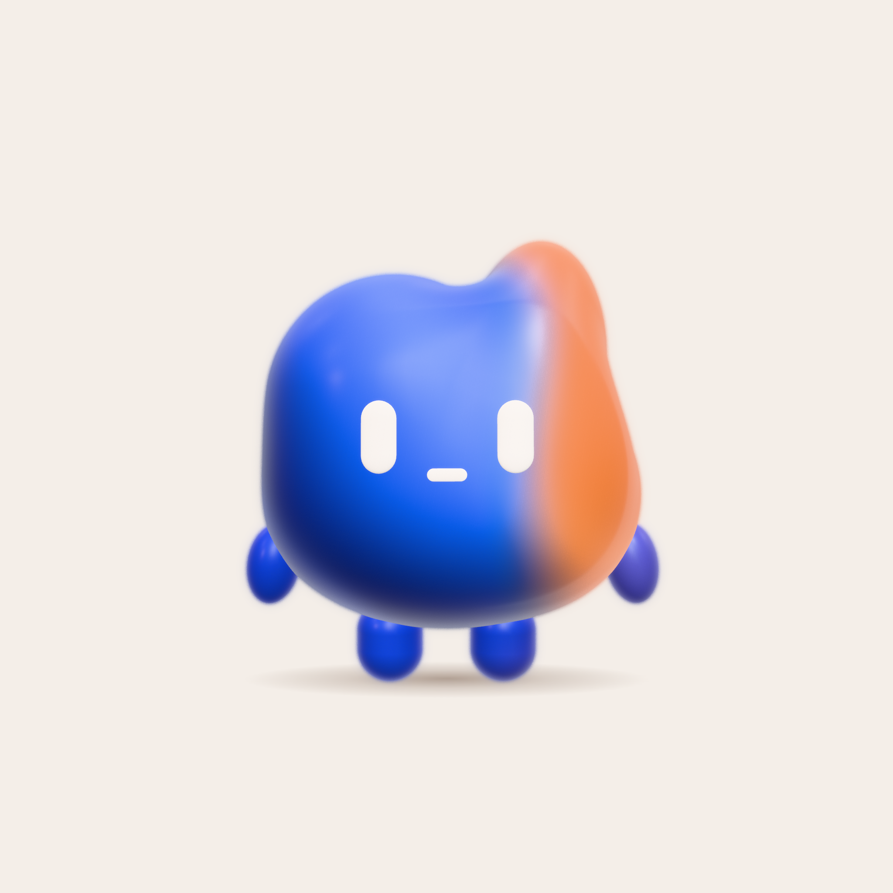

# AWI Animator · MVP



**Probalo en línea:** https://jokimori.github.io/awi-animator/

En la versión en línea el `.blend` se descarga como kit (el `.glb` más el script para Blender). Para generar el `.blend` directo, corré el servicio local de abajo.

Editor web (escritorio y celular) para animar a AWI en 3D y descargar MP4, `.glb` y `.blend`.

## Correr

```bash
python3 export_service.py
```

Abrí http://localhost:8765. El mismo proceso sirve la web y el servicio de exportación a `.blend`. Busca Blender en el `PATH` o en `/Applications/Blender.app`; también podés indicarlo con `BLENDER=/ruta/a/blender`.

## Archivos

| Archivo | Qué hace |
|---|---|
| `awi.js` | Modelo procedural de AWI: cuerpo con degradado y morphs (Inflado, Caído, Estirado), ojos (morph Feliz), boca (morphs Sonrisa, Ceño, Abierta), brazos y piernas articulados. |
| `anim.js` | Canales de pose, presets, interpolación de keyframes. |
| `app.js` | Escena (cámara frontal fija), panel, línea de tiempo, arrastre, guardado local y exportación. |
| `blender/awi_to_blend.py` | Importa el `.glb` en Blender y arma la escena: cámara, luces, piso y animación a 30 fps. Guarda el `.blend` y, si se le pide, renderiza un MP4. |
| `export_service.py` | Servidor local con `GET /api/health` y `POST /api/blend`, que recibe un `.glb` y devuelve un `.blend`. |

## Exportación

- **MP4:** se codifica en el navegador con WebCodecs (H.264) y mp4-muxer. Funciona en Chrome, Edge y Safari recientes.
- **.glb:** el clip se muestrea a 30 fps. Incluye la jerarquía de nodos (`AWI_root`, `AWI_armL`…) y los morphs.
- **.blend:** lo genera el servicio con Blender. Si el servicio no está activo, se descarga un kit `.zip` con el `.glb`, el script y las instrucciones.

Atajos: espacio para reproducir o pausar, K para agregar un keyframe, Supr para borrarlo, ←/→ para avanzar o retroceder un cuadro, ⌘Z para deshacer.

## Espíritu del bosque

- **Silueta:** se arma uniendo elipsoides de forma suave (SDF) y proyectando una esfera sobre esa superficie. Las medidas salen de la ilustración original.
- **Bruma:** dos resortes muy amortiguados (la copa del cuerpo y el aplastamiento) que hacen que AWI flote y se asiente sin rebotar, una ondulación lenta y un halo suave en los bordes. Todo corre en el shader, en la vista previa y en el MP4.
- **Degradado vivo:** el degradado azul → naranja se calcula en el shader con ruido animado. El canal *Calidez* se puede animar con keyframes.
- La gelatina, la ondulación y el degradado animado se ven en la web y en el MP4. En el `.glb` y el `.blend` el degradado queda fijo en los colores de vértice y la gelatina no viaja.
- **Aura (`aura.js`):** AWI se renderiza solo en una capa propia y después se difumina en dos escalas. Al componerlo sobre el fondo, los bordes se desvanecen en un halo claro, las uniones entre extremidades se funden y se suma grano de aerógrafo. Se controla con *Difuminado* y *Grano*. Se ve en la web y en el MP4.
- **Vidrio líquido:** material con barniz, iridiscencia suave y borde brillante. El degradado se deforma en remolinos y tiene vetas de luz que viajan por dentro.
- **Movimiento líquido:** lóbulos que se hinchan y se retraen, balanceo suave y un canal animable de *Agitación*: Enojado va rápido y grumoso, Triste casi quieto.
